# Section 4 Recurrent Neural Networks (RNNs) Notes

## Content
17.  [Day 15: Introduction to Sequence Modeling and RNNs](#17-day-15-introduction-to-sequence-modeling-and-rnns)
18.  [Day 16: Understanding RNN Architecture and Backpropagation Through Time (BPTT)](#18-day-16-understanding-rnn-architecture-and-backpropagation-through-time-bptt)
19.  [Day 17: Long Short-Term Memory (LSTM) Networks](#19-day-17-long-short-term-memory-lstm-networks)
20.  [Day 18: Gated Recurrent Units (GRUs)](#20-day-18-gated-recurrent-units-grus)
21.  [Day 19: Text Preprocessing and Word Embeddings for RNNs](#21-day-19-text-preprocessing-and-word-embeddings-for-rnns)
22.  [Day 20: Sequence-to-Sequence Models and Applications](#22-day-20-sequence-to-sequence-models-and-applications)
23.  [Day 21: RNN Project – Text Generation or Sentiment Analysis](#23-day-21-rnn-project--text-generation-or-sentiment-analysis)


## 17. Day 15: Introduction to Sequence Modeling and RNNs

[⬆ Back to content](#content)

**Overview of Sequence Modeling**

- What is sequence modeling?
  - Sequence modeling involves predicting or generating outputs based on sequential data.
  - Capture temporal or contextual dependencies.
  - Why is sequence modeling important?
    - Natural Language Processing (NLP)
      - Tasks like language modeling, machine translation and sentiment analysis depend on understanding sequential relationships in the text.
    - Time series analysis
      - Sequence models are essential for tasks like stock price prediction, weather forecasting and sensor data analysis.


**Introduction to Recurrent Neural Networks (RNNs)**

- What are RNNs?
  - Specialized neural networks for sequence modeling.
  - They include recurrent connections that allow them to maintain a "memory" of previous inputs.
  - Structure of RNN
    -  Input Layer - processes sequential data one step at a time.
    -  Hidden State - maintains information about past inputs.
    -  Recurrent Connections - pass hidden states from one time step to the next.

- Key concepts in RNNs
  - Hidden States - Represent memory at each time step
  - Recurrent Connections - enable information sharing across time steps
  - Vanishing Gradient Problem - Challenges in training long sequences due to diminishing gradients.


**Key Applications of RNNs in Machine Learning**

- Text Generation - Generates new text based on learned patterns.
- Language Translation - converts text from one language to another.
- Stock Price Prediction - predicts future stock prices using historic data.
- Speech Recognition - understands spoken words and phrases.
- Video Frame Prediction - anticipates future frames in video sequences.


**Hands-On Exercise**

Objective: Pre-process a text dataset for use in RNNs and set up an environment in TensorFlow and PyTorch for building RNNs.


### TensorFlow RNN Example

day15_tensorflow.py

```python
# import ready dataset - a standard data set for sentiment analysis, where each review is represented as a sequence of integers
from tensorflow.keras.datasets import imdb
# pad_sequences is used to ensure all sequences which are reviews are of the same length by padding or truncating them
from tensorflow.keras.preprocessing.sequence import pad_sequences
# TensorFlow for deep learning operations
import tensorflow as tf
# Sequential class used for building a sequential which is layer by layer model
from tensorflow.keras.models import Sequential
# These are these import specific layers
# Embedding converts word indices to dense vectors. SimpleRNN implements a basic RNN layer and Dense is fully connected layer for output
from tensorflow.keras.layers import Embedding, SimpleRNN, Dense

# Hyperparameters
## vocabulary size - the top 10,000 most frequent words will be used
vocab_size = 10000
## This is the maximum sequence length. Reviews will be truncated or padded to 200 words, so every review is 200 words.
max_len = 200

# Load the dataset and set training and testing data
## X_train, y_train, X_test, y_test are lists of integers representing word indices and binary label zero for negative and one for positive for the y I items.
(X_train, y_train), (X_test, y_test) = imdb.load_data(num_words=vocab_size)

# Preprocess the data
## Ensuring that all the reviews have the same length, which is max_len=200 and pad sequences with zeros at the end, which that's why we mentioned "post".
## Padding happens at the end and truncates reviews longer than 200 words if it's more than 200 words.
X_train = pad_sequences(X_train, maxlen=max_len, padding="post")
## Same thing for our test data set
X_test = pad_sequences(X_test, maxlen=max_len, padding="post")

# Print shapes of the datasets
print(f"Training Data Shape: {X_train.shape}")
print(f"Test Data Shape: {X_test.shape}")

# Build the model
## Using sequential, which is a model built for stacking layers sequentially
model = Sequential([
    ## setting input dim equal to vocab size where input vocabulary size is 10,000 words and output dim equal to 128,
    ## where each word index is mapped to a 128 dimensional vector.
    Embedding(input_dim=vocab_size, output_dim=128),
    # initializing simple RNN with 128 hidden units, 
    ## activation is tanh, 
    ## return_sequences=False - outputs only the last time steps results.
    SimpleRNN(128, activation='tanh', return_sequences=False),
    # creating a fully connected output layer using dense
    ## The 1 is the outputs a single value for binary classification
    ## activation is sigmoid - ensures the output is between 0 and 1 one probability
    Dense(1, activation='sigmoid')
])

# Compile the model
## optimizer='adam' - optimization algorithm for training the model
## loss='binary_crossentropy' - function for calculating loss for binary classification
## metrics=['accuracy'] - tracks the model accuracy during training process
model.compile(optimizer='adam', loss='binary_crossentropy', metrics=['accuracy'])

# Display the model summary including layers, parameters and output shapes
model.summary()

# Train the model
## X_train, y_train - training data and labels
## epochs=5 - number of epochs to train the model - five iterations over data set
## batch_size=32 - number of samples per batch - 32 processes 32 samples at a time.
## validation_split=0.2 - uses 20% of the training data for validation
history = model.fit(X_train, y_train, epochs=5, batch_size=32, validation_split=0.2)

# Evaluate the model
## X_test, y_test - test data and labels
loss, accuracy = model.evaluate(X_test, y_test)

# Print test loss and accuracy
print(f"Test Loss: {loss:.4f}, Test Accuracy: {accuracy:.4f}")

```

Run the file
    terminal --> python day15_tensorflow.py

Result:

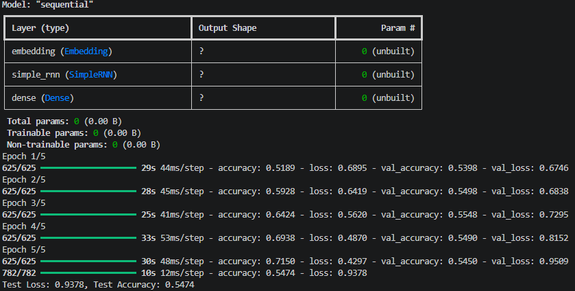
<br>
<br>


### PyTorch RNN Example

day15_pytorch.py

```python
# Import Libraries 
## Pytorch
import torch
## nn is used for building neural networks
import torch.nn as nn
## optim is used for optimizing neural networks
import torch.optim as optim
## utilities for working with data set which includes data loader for batching and tensor data set for packaging data.
## DataLoader is used to load data in batches
## TensorDataset is used to create a dataset from tensors
from torch.utils.data import DataLoader, TensorDataset
## tensorflow.keras provides access to popular image datasets
from tensorflow.keras.datasets import imdb
## pad_sequences - preprocessing - ensure all sequences which are reviews are of the same length by padding or truncating them
from tensorflow.keras.preprocessing.sequence import pad_sequences

# Hyperparameters
## vocabulary size - the top 10,000 most frequent words will be used
vocab_size = 10000
## This is the maximum sequence length. Reviews will be truncated or padded to 200 words, so every review is 200 words.
max_len = 200

# Load the dataset and set training and testing data
## X_train, y_train, X_test, y_test are lists of integers representing word indices and binary label zero for negative and one for positive for the y I items.
## X_train and X_test each review is a sequence of integers representing word indices. And y_train and y_test contains the binary sentiment labels of zero and one.
(X_train, y_train), (X_test, y_test) = imdb.load_data(num_words=vocab_size)

# Preprocess the data
## Ensuring that all the reviews have the same length, which is max_len=200 and pad sequences with zeros at the end, which that's why we mentioned "post".
## Padding happens at the end and truncates reviews longer than 200 words if it's more than 200 words.
X_train = pad_sequences(X_train, maxlen=max_len, padding="post")
## Same thing for our test data set.
X_test = pad_sequences(X_test, maxlen=max_len, padding="post")

# Prepare the data for PyTorch
## Converts numpy arrays into PyTorch tensors and creates a data set of paired inputs and labels
train_dataset = TensorDataset(torch.tensor(X_train), torch.tensor(y_train))
## This batches the data set into groups of 32 and shuffles the data for training
train_loader = DataLoader(train_dataset, batch_size=32, shuffle=True)

# Define a RNN Model
class RNNModel(nn.Module):
    ## Constructor
    def __init__(self, vocab_size, embedding_dim, hidden_dim, output_dim):
        ## Call the parent class constructor
        super(RNNModel, self).__init__()
        ## Embedding layer to transform the input data into a dense vector of a fixed size
        ## ## nn.Embedding embeds the input word indices into dense vectors
        self.embedding = nn.Embedding(vocab_size, embedding_dim)
        ## nn.RNN - simple recurrent neural network layer
        self.rnn = nn.RNN(embedding_dim, hidden_dim, batch_first=True)
        ## nn.Linear - Fully connected layer - Mapping the RNN outputs to the final binary sentiment prediction.
        self.fc = nn.Linear(hidden_dim, output_dim)
    
    # Forward pass function
    def forward(self, x):
        ## Embed the input sequences
        embedded = self.embedding(x)
        ## Pass the embedded sequences to the RNN
        ## hidden, contains the RNNs last hidden state
        output, hidden = self.rnn(embedded)
        ## Applies the fully connected layer to the hidden state and uses the sigmoid activation to output the probabilities
        return torch.sigmoid(self.fc(hidden.squeeze(0)))

# Initialize the model
## vocab_size=10000 - the top 10,000 most frequent words will be used
## embedding_dim=128 - the dimensionality of the word embeddings
## hidden_dim=128 - the dimensionality of the hidden state of the RNN
## output_dim=1 - the output dimensionality for binary classification so it will be 0 or 1
model = RNNModel(vocab_size=10000, embedding_dim=128, hidden_dim=128, output_dim=1)

# Define the loss function and optimizer
## criterion is what computes the binary cross entropy loss for the predictions
## nn.BCELoss - Binary Cross Entropy Loss
criterion = nn.BCELoss()
## optimizer optimizes the model using Adam with a learning rate of 0.001
## optim.Adam - Stochastic Gradient Descent
optimizer = optim.Adam(model.parameters(), lr=0.001)

# Training function
def train_rnn(model, train_loader, criterion, optimizer, epochs=5):
    model.train()
    for epoch in range(epochs):                                      # for each epoch
        epoch_loss = 0                                               # cumulative loss initially to zero
        for X_batch, y_batch in train_loader:                        # for each batch in the train loader
            optimizer.zero_grad()                                    # ptimizer zero grad, which clears the previous gradients that has been calculated
            predictions = model(X_batch).squeeze(1)             # make the predictions
            loss = criterion(predictions, y_batch.float())      # calculate the loss
            # computing the computing the gradients
            loss.backward()                                          # backpropagate the loss
            optimizer.step()                                         # pdates the model weights
            epoch_loss += loss.item()                                # adding the batch loss to epoch loss here and keep on incrementing
        # print the epoch loss
        print(f"Epoch {epoch+1}, Loss: {epoch_loss/len(train_loader):.4f}")

# Train the model
train_rnn(model, train_loader, criterion, optimizer)

# Evaluation function 
def evaluate_rnn(model, X_test, y_test):
    model.eval()                                                                     # set the model to evaluation mode
    with torch.no_grad():                                                            # disable gradient computation for eficiency
        predications = model(torch.tensor(X_test)).squeeze(1)                   # make the predictions
        loss = criterion(predications, torch.tensor(y_test).float())            # calculate the loss
        accuracy = ((predications > 0.5) == torch.tensor(y_test).float()).float().mean().item()         # calculate the accuracy
    # print the loss and accuracy
    print(f"Test Loss: {loss.item():.4f}, Test Accuracy: {accuracy:.4f}")

# Evaluate the model
evaluate_rnn(model, X_test, y_test)

```

Run the file
    terminal --> python day15_pytorch.py

Result:

Epoch 1, Loss: 0.6832       
Epoch 2, Loss: 0.6780       
Epoch 3, Loss: 0.6888       
Epoch 4, Loss: 0.6846       
Epoch 5, Loss: 0.6789       
Test Loss: 0.6806, Test Accuracy: 0.5370    


So this is how you can pre-process a text data set using for use in RNNs and set up an environment in both, as we saw TensorFlow and PyTorch for building RNNs.

We understood the importance of sequence modeling in NLP and time series analysis. We learned the structure and functioning of recurrent neural networks. We gained hands-on experience setting up environments and preparing data sets for RNNs, and we finally built foundational knowledge for advanced sequence modeling tasks.


[⬆ Back to content](#content)


## 18. Day 16: Understanding RNN Architecture and Backpropagation Through Time (BPTT)

[⬆ Back to content](#content)


**Detailed Architecture of RNN**

- Components of RNN
  - Input Layer - takes sequential data (example: words, characters or time series values) as input at each time step
  - Hidden Layer - maintains a memory of the past inputs through recurrent connections. The hidden state at time T(h(t)) is calculated as
    - h(t) = f(W(h) * h(t-1) + W(x) * x(t) + b(h))
    - W(h) - Weight matrix for recurrent connections
    - W(x) - Weight matrix for input connections
    - b(h) - Bias term
    - f - Non-linear activation function (example tanh, ReLU)
  - Output Layer
    - Produces output y t based on the hidden state of h(t)
    - y(t) = g(W(y) * h(t) +b(y))
      - g - activation function (e.g. softmax for classification)


**Back Propagation Through Time (BPTT)**

- Now what is BPTT?
  - Extension of standard back propagation to handle sequential data in RNNs
  - It calculates gradients for each time step and propagates them backward through the sequence
  - Steps for BPTT
    - Unroll the RNN across the sequence for a fixed number of time steps
    - Compute the loss for each time step
    - Back propagate the errors across all time steps to update the weights
  - Challenges in BPTT
    - Vanishing Gradient Problem 
      - Gradients diminish exponentially as they are propagated back through time
      - Leads to difficulty in learning long term dependencies
    - Exploding Gradient Problem
      - Gradients grow exponentially, causing numerical instability during the training process
  - Solutions
    - Use gradient clipping to handle the exploding gradients problem
    - Use architecture like long short term memory (LSTM) or gated recurrent unit (GRU) to mitigate the vanishing gradient problem


**Limitations of Vanilla RNNs**

- Short Term Memory - Struggle to learn dependencies in long sequences due to the vanishing gradients
- Sequential Computation - cannot Parallelize training across time steps, making them computationally expensive
- Sensitive Initialization - performance depends heavily on proper weight initialization and learning rates


**Hands-On Exercise**

Objective: Build a simple RNN model for text classification using TensorFlow and PyTorch


### RNN with BPTT with TensorFlow

day16_tensorflow.py

```python
# Import Libraries
# import ready dataset - a standard data set for sentiment analysis, where each review is represented as a sequence of integers
from tensorflow.keras.datasets import imdb
# pad_sequences is used to ensure all sequences which are reviews are of the same length by padding or truncating them
from tensorflow.keras.preprocessing.sequence import pad_sequences
# TensorFlow for deep learning operations
import tensorflow as tf
# Sequential class used for building a sequential which is layer by layer model
from tensorflow.keras.models import Sequential
# These are these import specific layers
# Embedding converts word indices to dense vectors. SimpleRNN implements a basic RNN layer and Dense is fully connected layer for output
from tensorflow.keras.layers import Embedding, SimpleRNN, Dense

# Hyperparameters
## vocabulary size - the top 10,000 most frequent words will be used
vocab_size = 10000
## This is the maximum sequence length. Reviews will be truncated or padded to 200 words, so every review is 200 words.
max_len = 200

# Load the dataset and set training and testing data
## X_train, y_train, X_test, y_test are lists of integers representing word indices and binary label zero for negative and one for positive for the y I items.
(X_train, y_train), (X_test, y_test) = imdb.load_data(num_words=vocab_size)

# Preprocess the data
## Ensuring that all the reviews have the same length, which is max_len=200 and pad sequences with zeros at the end, which that's why we mentioned "post".
## Padding happens at the end and truncates reviews longer than 200 words if it's more than 200 words.
X_train = pad_sequences(X_train, maxlen = max_len, padding="post")
## Same thing for our test data set
X_test = pad_sequences(X_test, maxlen = max_len, padding="post")

# Print shapes of the datasets
print(f"Training Data Shape: {X_train.shape}")
print(f"Test Data Shape: {X_test.shape}")

# Build the model
## Using sequential, which is a model built for stacking layers sequentially
model = Sequential([
    ## setting input dim equal to vocab size where input vocabulary size is 10,000 words and output dim equal to 128,
    ## where each word index is mapped to a 128 dimensional vector
    Embedding(input_dim=vocab_size, output_dim=128),
    # initializing simple RNN with 128 hidden units, 
    ## activation is tanh, 
    ## return_sequences=False - outputs only the last time steps results.
    SimpleRNN(128, activation='tanh', return_sequences=False),
    # creating a fully connected output layer using dense
    ## The 1 is the outputs a single value for binary classification
    ## activation is sigmoid - ensures the output is between 0 and 1 one probability
    Dense(1, activation='sigmoid')
])

# Compile the model
## optimizer='adam' - optimization algorithm for training the model
## loss='binary_crossentropy' - function for calculating loss for binary classification
## metrics=['accuracy'] - tracks the model accuracy during training process
model.compile(optimizer='adam', loss='binary_crossentropy', metrics=['accuracy'])

# Display the model summary including layers, parameters and output shapes
model.summary()

# Train the model
## X_train, y_train - training data and labels
## epochs=5 - number of epochs to train the model - five iterations over data set
## batch_size=32 - number of samples per batch - 32 processes 32 samples at a time.
## validation_split=0.2 - uses 20% of the training data for validation
history = model.fit(X_train, y_train, epochs=5, batch_size=32, validation_split=0.2)

# Evaluate the model
## X_test, y_test - test data and labels
loss, accuracy = model.evaluate(X_test, y_test)

# Print test loss and accuracy
print(f"Test Loss: {loss:.4f}, Test Accuracy: {accuracy:.4f}")

```

Run the file
    terminal --> python day16_tensorflow.py

Result:

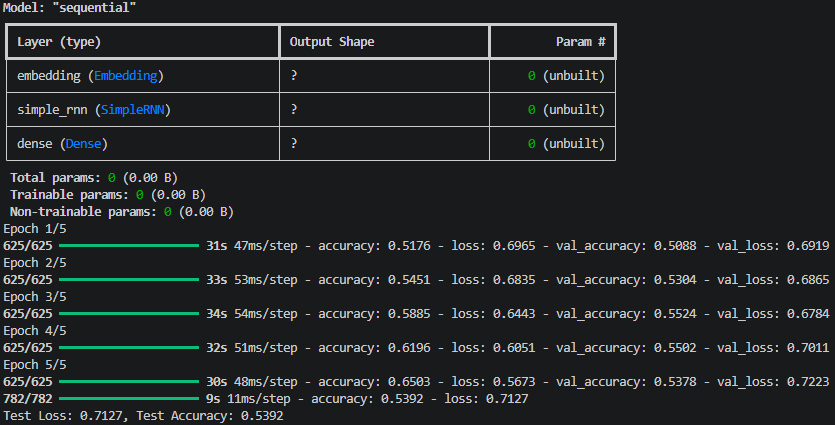
<br>
<br>

### RNN with BPTT with PyTorch

day16_pytorch.py

```python
## Pytorch
import torch
## nn is used for building neural networks
import torch.nn as nn
## optim is used for optimizing neural networks
import torch.optim as optim
## utilities for working with data set which includes data loader for batching and tensor data set for packaging data.
## DataLoader is used to load data in batches
## TensorDataset is used to create a dataset from tensors
from torch.utils.data import DataLoader, TensorDataset
## tensorflow.keras provides access to popular image datasets
from tensorflow.keras.datasets import imdb
## pad_sequences - preprocessing - ensure all sequences which are reviews are of the same length by padding or truncating them
from tensorflow.keras.preprocessing.sequence import pad_sequences

# Hyperparameters
## vocabulary size - the top 10,000 most frequent words will be used
vocab_size = 10000
## This is the maximum sequence length. Reviews will be truncated or padded to 200 words, so every review is 200 words.
max_len = 200

# Load the dataset and set training and testing data
## X_train, y_train, X_test, y_test are lists of integers representing word indices and binary label zero for negative and one for positive for the y I items.
## X_train and X_test each review is a sequence of integers representing word indices. And y_train and y_test contains the binary sentiment labels of zero and one.
(X_train, y_train), (X_test, y_test) = imdb.load_data(num_words=vocab_size)

# Preprocess the data
## Ensuring that all the reviews have the same length, which is max_len=200 and pad sequences with zeros at the end, which that's why we mentioned "post".
## Padding happens at the end and truncates reviews longer than 200 words if it's more than 200 words.
X_train = pad_sequences(X_train, maxlen = max_len, padding="post")
## Same thing for our test data set.
X_test = pad_sequences(X_test, maxlen = max_len, padding="post")

# Prepare the data for PyTorch
## Converts numpy arrays into PyTorch tensors and creates a data set of paired inputs and labels
train_dataset = TensorDataset(torch.tensor(X_train), torch.tensor(y_train))
## This batches the data set into groups of 32 and shuffles the data for training
train_loader = DataLoader(train_dataset, batch_size=32, shuffle=True)

# Define a RNN Model
class RNNModel(nn.Module):
    ## Constructor
    def __init__(self, vocab_size, embedding_dim, hidden_dim, output_dim):
        ## Call the parent class constructor
        super(RNNModel, self).__init__()
        ## Embedding layer to transform the input data into a dense vector of a fixed size
        ## nn.Embedding embeds the input word indices into dense vectors
        self.embedding = nn.Embedding(vocab_size, embedding_dim)
        ## nn.RNN - simple recurrent neural network layer
        self.rnn = nn.RNN(embedding_dim, hidden_dim, batch_first=True)
        ## nn.Linear - Fully connected layer - Mapping the RNN outputs to the final binary sentiment prediction.
        self.fc = nn.Linear(hidden_dim, output_dim)
        
    # Forward pass function
    def forward(self, x):
        ## Embed the input sequences
        embedded = self.embedding(x)
        ## Pass the embedded sequences to the RNN
        ## hidden, contains the RNNs last hidden state
        output, hidden = self.rnn(embedded)
        ## Applies the fully connected layer to the hidden state and uses the sigmoid activation to output the probabilities
        return torch.sigmoid(self.fc(hidden.squeeze(0)))
    
# Initialize the model
## vocab_size=10000 - the top 10,000 most frequent words will be used
## embedding_dim=128 - the dimensionality of the word embeddings
## hidden_dim=128 - the dimensionality of the hidden state of the RNN
## output_dim=1 - the output dimensionality for binary classification so it will be 0 or 1
model = RNNModel(vocab_size=10000, embedding_dim=128, hidden_dim=128, output_dim=1)

# Define the loss function and optimizer
## criterion is what computes the binary cross entropy loss for the predictions
## nn.BCELoss - Binary Cross Entropy Loss
criterion = nn.BCELoss()
## optimizer optimizes the model using Adam with a learning rate of 0.001
## optim.Adam - Stochastic Gradient Descent
optimizer = optim.Adam(model.parameters(), lr=0.001)

# Training function
def train_rnn(model, train_loader, criterion, optimizer, epochs=5):
    model.train()
    for epoch in range(epochs):                                         # for each epoch
        epoch_loss = 0                                                  # cumulative loss initially to zero
        for X_batch, y_batch in train_loader:                           # for each batch in the train loader
            optimizer.zero_grad()                                       # ptimizer zero grad, which clears the previous gradients that has been calculated
            predictions = model(X_batch).squeeze(1)                # make the predictions
            loss = criterion(predictions, y_batch.float())         # calculate the loss
            # computing the computing the gradients
            loss.backward()                                             # backpropagate the loss
            optimizer.step()                                            # pdates the model weights
            epoch_loss += loss.item()                                   # adding the batch loss to epoch loss 
        # print the epoch loss
        print(f"Epoch {epoch+1}, Loss: {epoch_loss/len(train_loader):.4f}")

# Train the model
train_rnn(model, train_loader, criterion, optimizer)

# Evaluation function 
def evaluate_rnn(model, X_test, y_test):
    model.eval()                                    # set the model to evaluation mode
    with torch.no_grad():                           # disable gradient computation for eficiency
        predictions = model(torch.tensor(X_test)).squeeze(1)                # make the predictions
        loss = criterion(predictions, torch.tensor(y_test).float())         # calculate the loss
        accuracy = ((predictions > 0) == torch.tensor(y_test).float()).float().mean().item()        # calculate the accuracy
    # print the loss and accuracy
    print(f"Test Loss: {loss.item():.4f}, Test Accuracy: {accuracy:.4f}")

# Evaluate the model
evaluate_rnn(model, X_test, y_test)

```

Run the file
    terminal --> python day16_pytorch.py

Result:

Epoch 1, Loss: 0.6888       
Epoch 2, Loss: 0.6714       
Epoch 3, Loss: 0.6410       
Epoch 4, Loss: 0.6058       
Epoch 5, Loss: 0.5662       
Test Loss: 0.6875, Test Accuracy: 0.5000        


We gained a deep understanding of RNN architecture, including the hidden states and recurrent connections.
We learned the concept and challenges of back propagation through time, which is BPTT. We understood the limitations of vanilla RNNs and why they struggle with long sequences, and we developed hands on skills in implementing RNNs in TensorFlow and PyTorch for sequence based tasks.


[⬆ Back to content](#content)


## 19. Day 17: Long Short-Term Memory (LSTM) Networks

[⬆ Back to content](#content)

**Introduction to LSTMs and How They Address RNN Limitations**

- What are LSTMs?
  - Long Short Term Memory (LSTM) networks are a type of recurrent neural networks (RNNs) specifically designed to handle long term dependencies
  - LSTMs mitigate the vanishing gradient problem by using specialized gates to manage the flow of information
  - Key features of LSTMs
    - Memory Cells - maintains a long term memory state across sequences
    - Gated Mechanisms - regulates how much information to keep, update or forget at each time step
    - Effective for Long Sequences - handles sequential data with dependencies across many time steps

- Advantages of LSTM Over vanilla RNNs?
  - Retains long-term dependencies
  - Prevents gradient related issues during training
  - Outperforms RNNs on tasks like language modeling, speech recognition and time series forecasting


**LSTM Cell Structure: Input, Forget and Output Gates**

- Forget Gate
  - Decides what information to discard from the cell state
  - Formula: 
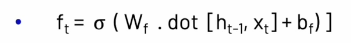
<br>
<br>

      - W(f) - weight matrix for the forget gate
      - f(t) - forget gate output,
      - x(t) - input
      - h(t-1) - previous hidden state      


- Input Gate
  - Decides what new information to add to the cell state
  - Formula: 
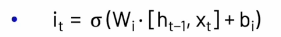
<br>
<br>

      - σ - sigmoid activation function
      - W(i) - weight matrix for the input gate
      - h(t-1) - hidden state for the previous time step
      - x(t) - current input
      - b(i) - bias for the input gate


- Cell State Update
  - Combines the forget gate and input gate results to update the cell state
  - Formula: 
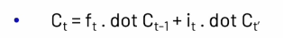
<br>
<br>

- Output Gate
  - Decides what information to output at each time step
  - Formula: 
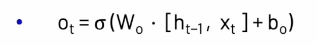
<br>
<br>

      - W(o) - weight matrix for the output gate
      - b(o) - bias for the output gate


**Applications of LSTMs**

- Natural Language Processing (NLP) - Sentiment analysis. Machine translation and Text Generation
- Time-Series Forecasting - predicting stock prices, weather patterns or sales trends
- Speech Recognition - converting spoken words into text
- Anomaly Detection - identifying unusual patterns in sequential data


**Hands-On Exercise**

Objective: Build an LSTM model for sentiment analysis on the IMDb Movie Reviews dataset and compare its performance with the basic RNN model.

Today we are going to use TensorFlow only.

day17_ex.py

```python
# import ready dataset - a standard data set for sentiment analysis, where each review is represented as a sequence of integers
from tensorflow.keras.datasets import imdb
# pad_sequences is used to ensure all sequences which are reviews are of the same length by padding or truncating them
from tensorflow.keras.preprocessing.sequence import pad_sequences
# TensorFlow for deep learning operations
import tensorflow as tf
# Sequential class used for building a sequential which is layer by layer model
from tensorflow.keras.models import Sequential
# These are these import specific layers
# Embedding converts word indices to dense vectors. SimpleRNN implements a basic RNN layer and Dense is fully connected layer for output, LSTM is long short term memory
from tensorflow.keras.layers import Embedding, SimpleRNN, LSTM, Dense

# Hyperparameters
## vocabulary size - the top 10,000 most frequent words will be used
vocab_size = 10000
## This is the maximum sequence length. Reviews will be truncated or padded to 200 words, so every review is 200 words.
max_len = 200

# Load the dataset and set training and testing data
## X_train, y_train, X_test, y_test are lists of integers representing word indices and binary label zero for negative and one for positive for the y I items.
(X_train, y_train), (X_test, y_test) = imdb.load_data(num_words=vocab_size)

# Preprocess the data
## Ensuring that all the reviews have the same length, which is max_len=200 and pad sequences with zeros at the end, which that's why we mentioned "post".
## Padding happens at the end and truncates reviews longer than 200 words if it's more than 200 words.
X_train = pad_sequences(X_train, maxlen=max_len, padding='post')
## Same thing for our test data set
X_test = pad_sequences(X_test, maxlen=max_len, padding='post')

# Print shapes of the datasets
print(f"Training Data Shape: {X_train.shape}")
print(f"Test Data Shape: {X_test.shape}")

# Build the model
rnn_model = Sequential([
    ## setting input dim equal to vocab size where input vocabulary size is 10,000 words and output dim equal to 128,
    ## where each word index is mapped to a 128 dimensional vector.
    Embedding(input_dim=vocab_size, output_dim=128),
    # initializing simple RNN with 128 hidden units, 
    ## activation is tanh, 
    ## return_sequences=False - outputs only the last time steps results.
    SimpleRNN(128, activation='tanh', return_sequences=False),
    # creating a fully connected output layer using dense
    ## The 1 is the outputs a single value for binary classification
    ## activation is sigmoid - ensures the output is between 0 and 1 one probability
    Dense(1, activation='sigmoid')
])

# Compile the model
## optimizer='adam' - optimization algorithm for training the model
## loss='binary_crossentropy' - function for calculating loss for binary classification
## metrics=['accuracy'] - tracks the model accuracy during training process
rnn_model.compile(optimizer='adam', loss='binary_crossentropy', metrics=['accuracy'])

# Display the model summary including layers, parameters and output shapes
rnn_model.summary()

# Train the model
## X_train, y_train - training data and labels
## epochs=5 - number of epochs to train the model - five iterations over data set
## batch_size=32 - number of samples per batch - 32 processes 32 samples at a time.
## validation_split=0.2 - uses 20% of the training data for validation
rnn_history = rnn_model.fit(X_train, y_train, epochs=5, batch_size=32, validation_split=0.2)

# Evaluate the model
## X_test, y_test - test data and labels
rnn_loss, rnn_accuracy = rnn_model.evaluate(X_test, y_test)
print(f"RNN Test Loss: {rnn_loss:.4f}, Test Accuracy: {rnn_accuracy:.4f}")

# Build the LSTM model
## Using sequential, which is a model built for stacking layers sequentially
lstm_model = Sequential([
    ## setting input dim equal to vocab size where input vocabulary size is 10,000 words and output dim equal to 128,
    ## where each word index is mapped to a 128 dimensional vector
    Embedding(input_dim=vocab_size, output_dim=128),
    # initializing LSTM with 128 hidden units, 
    ## activation is tanh, 
    ## return_sequences=False - outputs only the last time steps results
    LSTM(128, activation='tanh', return_sequences=False),
    # creating a fully connected output layer using dense
    ## The 1 is the outputs a single value for binary classification
    ## activation is sigmoid - ensures the output is between 0 and 1 one probability
    Dense(1, activation='sigmoid')
])

# Compile the LSTM model
## optimizer='adam' - optimization algorithm for training the model
## loss='binary_crossentropy' - function for calculating loss for binary classification
## metrics=['accuracy'] - tracks the model accuracy during training process
lstm_model.compile(optimizer='adam', loss='binary_crossentropy', metrics=['accuracy'])
# Display the LSTM model summary including layers, parameters and output shapes
lstm_model.summary()

# Train the LSTM model
## X_train, y_train - training data and labels
## epochs=5 - number of epochs to train the model - five iterations over data set
## batch_size=32 - number of samples per batch - 32 processes 32 samples at a time.
## validation_split=0.2 - uses 20% of the training data for validation
lstm_history = lstm_model.fit(X_train, y_train, epochs=5, batch_size=32, validation_split=0.2)

# Evaluate the LSTM model
## X_test, y_test - test data and labels
lstm_loss, lstm_accuracy = lstm_model.evaluate(X_test, y_test)

# Print test loss and accuracy for LSTM model
print(f"LSTM Test Loss: {lstm_loss:.4f}, Test Accuracy: {lstm_accuracy:.4f}")

```

Run the file
    terminal --> python day17_ex.py

Result:

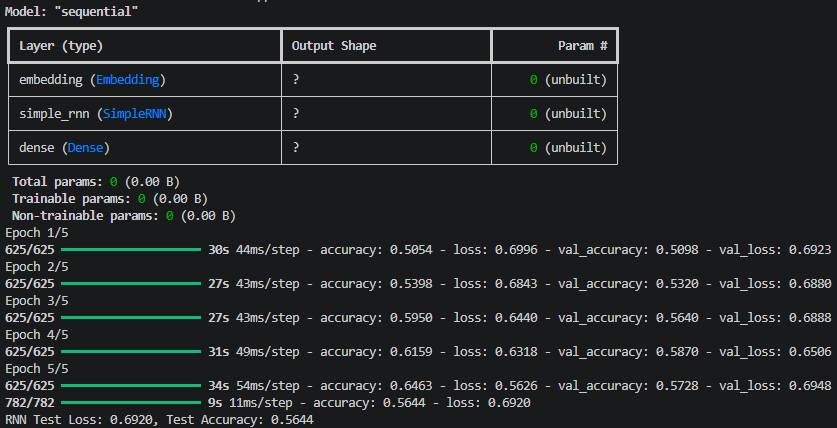
<br>
<br>

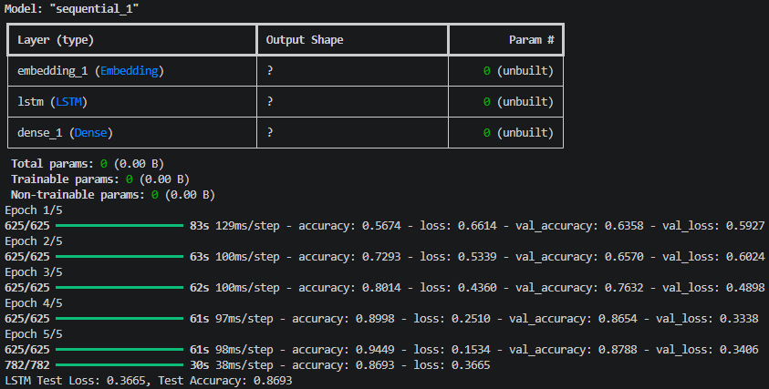
<br>
<br>

LSTM model is more accurate.

Today we went and understood the architecture of LSTMs, including input forget and output gates. We learned how LSTMs address limitations of vanilla RNNs. We gained hands-on experience building LSTM for sentiment analysis, and we compared LSTM performance with RNN and interpreted the results.


[⬆ Back to content](#content)


## 20. Day 18: Gated Recurrent Units (GRUs)

[⬆ Back to content](#content)

**Introduction to Gated Recurrent Units (GRUs)**

- What are GRUs? 
  - Simplified variant of long short term memory LSTM networks 
  - Designed to retain long term dependencies while reducing computational complexity by having fewer parameters
  - Key features of GRUs
    - Simpler architecture
      - GRUs have two gates (update and reset) compared to LSTMs three gates (input, forget and output)
    - Efficiency
      - Fewer parameters make GRU computationally faster and less prone to overfitting on smaller datasets
    - Retains Performance
      - Comparable to LSTMs in terms of capturing sequential dependencies


**GRU Cell Structure: Update and Reset Gates**

- Update Gate
  - Determines how much of the previous hidden state to retain and how much to update with the new information
- Reset Gate
  - Controls how much of the past information to forget when combining with new input
- Hidden State Update
  - Combines the new information and the past hidden state based on the reset and update gates


**When to Use Grus vs. LSTMs**

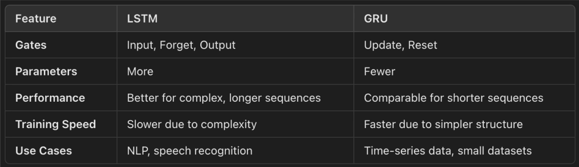
<br>
<br>


**Hands-On Exercise**

Objective: Build a GRU based model for the IMDb movie review data set and compare its performance with LSTM model


day18_ex.py

```python
# import ready dataset - a standard data set for sentiment analysis, where each review is represented as a sequence of integers
from tensorflow.keras.datasets import imdb
# pad_sequences is used to ensure all sequences which are reviews are of the same length by padding or truncating them
from tensorflow.keras.preprocessing.sequence import pad_sequences
# TensorFlow for deep learning operations
import tensorflow as tf
# Sequential class used for building a sequential which is layer by layer model
from tensorflow.keras.models import Sequential
# These are these import specific layers
# Embedding converts word indices to dense vectors. SimpleRNN implements a basic RNN layer and Dense is fully connected layer for output, LSTM is long short term memory,  GRU is gated recurrent unit
from tensorflow.keras.layers import Embedding, SimpleRNN, LSTM, GRU, Dense

# Hyperparameters
## vocabulary size - the top 10,000 most frequent words will be used
vocab_size = 10000
## This is the maximum sequence length. Reviews will be truncated or padded to 200 words, so every review is 200 words.
max_len = 200

# Load the dataset and set training and testing data
## X_train, y_train, X_test, y_test are lists of integers representing word indices and binary label zero for negative and one for positive for the y I items.
(X_train, y_train), (X_test, y_test) = imdb.load_data(num_words=vocab_size)

# Preprocess the data
## Ensuring that all the reviews have the same length, which is max_len=200 and pad sequences with zeros at the end, which that's why we mentioned "post".
## Padding happens at the end and truncates reviews longer than 200 words if it's more than 200 words.
X_train = pad_sequences(X_train, maxlen=max_len, padding='post')
## Same thing for our test data set
X_test = pad_sequences(X_test, maxlen=max_len, padding='post')

# Print shapes of the datasets
print(f"Training Data Shape: {X_train.shape}")
print(f"Test Data Shape: {X_test.shape}")

# Build RNN model
rnn_model = Sequential([
    ## setting input dim equal to vocab size where input vocabulary size is 10,000 words and output dim equal to 128,
    ## where each word index is mapped to a 128 dimensional vector.
    Embedding(input_dim=vocab_size, output_dim=128),
    # initializing simple RNN with 128 hidden units, 
    ## activation is tanh, 
    ## return_sequences=False - outputs only the last time steps results.
    SimpleRNN(128, activation='tanh', return_sequences=False),
    # creating a fully connected output layer using dense
    ## The 1 is the outputs a single value for binary classification
    ## activation is sigmoid - ensures the output is between 0 and 1 one probability
    Dense(1, activation='sigmoid')
])

# Compile the model
## optimizer='adam' - optimization algorithm for training the model
## loss='binary_crossentropy' - function for calculating loss for binary classification
## metrics=['accuracy'] - tracks the model accuracy during training process
rnn_model.compile(optimizer='adam', loss='binary_crossentropy', metrics=['accuracy'])
# Display the model summary including layers, parameters and output shapes
rnn_model.summary()

# Train the model
## X_train, y_train - training data and labels
## epochs=5 - number of epochs to train the model - five iterations over data set
## batch_size=32 - number of samples per batch - 32 processes 32 samples at a time.
## validation_split=0.2 - uses 20% of the training data for validation
rnn_history = rnn_model.fit(X_train, y_train, epochs=5, batch_size=32, validation_split=0.2)

# Evaluate the model
## X_test, y_test - test data and labels
rnn_loss, rnn_accuracy = rnn_model.evaluate(X_test, y_test)
print(f"RNN Test Loss: {rnn_loss:.4f}, Test Accuracy: {rnn_accuracy:.4f}")

# Build the LSTM model
## Using sequential, which is a model built for stacking layers sequentially
lstm_model = Sequential([
    ## setting input dim equal to vocab size where input vocabulary size is 10,000 words and output dim equal to 128,
    ## where each word index is mapped to a 128 dimensional vector
    Embedding(input_dim=vocab_size, output_dim=128),
    # initializing LSTM with 128 hidden units, 
    ## activation is tanh, 
    ## return_sequences=False - outputs only the last time steps results
    LSTM(128, activation='tanh', return_sequences=False),
    # creating a fully connected output layer using dense
    ## The 1 is the outputs a single value for binary classification
    ## activation is sigmoid - ensures the output is between 0 and 1 one probability
    Dense(1, activation='sigmoid')
])

# Compile the LSTM model
## optimizer='adam' - optimization algorithm for training the model
## loss='binary_crossentropy' - function for calculating loss for binary classification
## metrics=['accuracy'] - tracks the model accuracy during training process
lstm_model.compile(optimizer='adam', loss='binary_crossentropy', metrics=['accuracy'])
# Display the LSTM model summary including layers, parameters and output shapes
lstm_model.summary()

# Train the LSTM model
## X_train, y_train - training data and labels
## epochs=5 - number of epochs to train the model - five iterations over data set
## batch_size=32 - number of samples per batch - 32 processes 32 samples at a time.
## validation_split=0.2 - uses 20% of the training data for validation
lstm_history = lstm_model.fit(X_train, y_train, epochs=5, batch_size=32, validation_split=0.2)


# Evaluate the LSTM model
## X_test, y_test - test data and labels
lstm_loss, lstm_accuracy = lstm_model.evaluate(X_test, y_test)
# Print test loss and accuracy for LSTM model
print(f"LSTM Test Loss: {lstm_loss:.4f}, Test Accuracy: {lstm_accuracy:.4f}")

# Build the GRU model
## Using sequential, which is a model built for stacking layers sequentially
gru_model = Sequential([
    ## setting input dim equal to vocab size where input vocabulary size is 10,000 words and output dim equal to 128,
    ## where each word index is mapped to a 128 dimensional vector
    Embedding(input_dim=vocab_size, output_dim=128),
    # initializing GRU with 128 hidden units,
    ## activation is tanh,
    ## return_sequences=False - outputs only the last time steps results
    GRU(128, activation='tanh', return_sequences=False),
    # creating a fully connected output layer using dense
    ## The 1 is the outputs a single value for binary classification
    ## activation is sigmoid - ensures the output is between 0 and 1 one probability
    Dense(1, activation='sigmoid')
])

# Compile the GRU model
## optimizer='adam' - optimization algorithm for training the model
## loss='binary_crossentropy' - function for calculating loss for binary classification
## metrics=['accuracy'] - tracks the model accuracy during training process
gru_model.compile(optimizer='adam', loss='binary_crossentropy', metrics=['accuracy'])
# Display the GRU model summary including layers, parameters and output shapes
gru_model.summary()

# Train the GRU model
## X_train, y_train - training data and labels
## epochs=5 - number of epochs to train the model - five iterations over data set
## batch_size=32 - number of samples per batch - 32 processes 32 samples at a time.
## validation_split=0.2 - uses 20% of the training data for validation
gru_history = gru_model.fit(X_train, y_train, epochs=5, batch_size=32, validation_split=0.2)

# Evaluate the GRU model
## X_test, y_test - test data and labels
gru_loss, gru_accuracy = gru_model.evaluate(X_test, y_test)
## Print test loss and accuracy for GRU model
print(f"GRU Test Loss: {gru_loss:.4f}, Test Accuracy: {gru_accuracy:.4f}")

```

Run the file
    terminal --> python day18_ex.py

Result:

RNN model results:

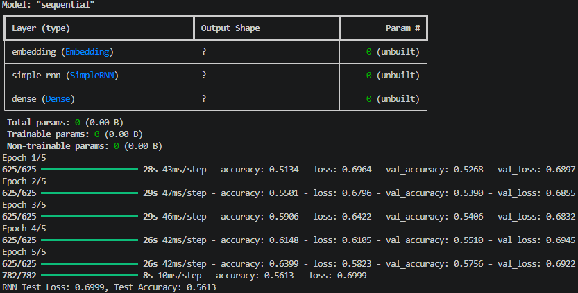
<br>
<br>

LSTM model results:

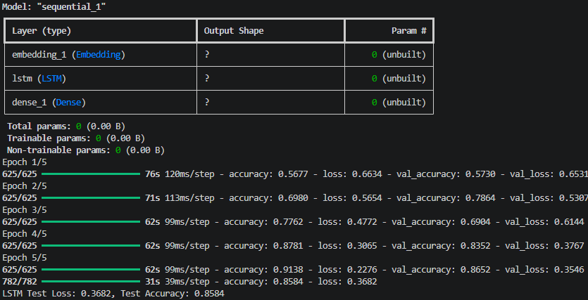
<br>
<br>

GRU model results:

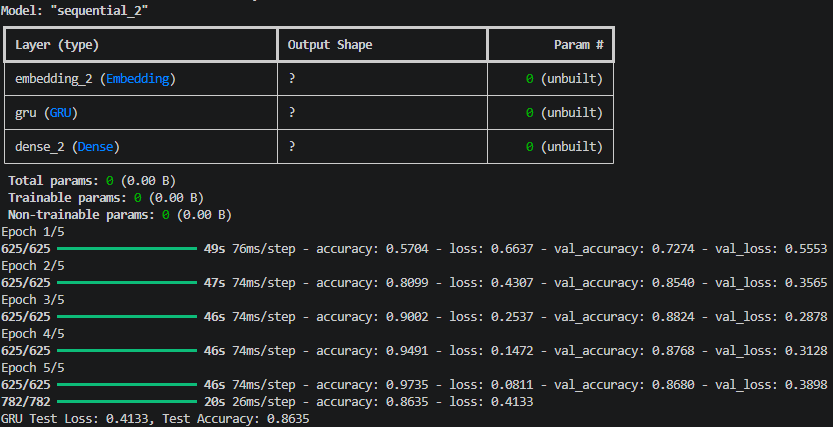
<br>
<br>


We understood the structure and functionality of Grus including update and reset gates. We learned when to choose GRU over LSTM for sequence modeling tasks. We gained hands-on experience building GRU based models for NLP tasks. And finally, we compared GRU performance with LSTM models to identify the tradeoffs.


[⬆ Back to content](#content)


## 21. Day 19: Text Preprocessing and Word Embeddings for RNNs

[⬆ Back to content](#content)

**Importance of Text Preprocessing**

- What is text preprocessing?
  - Involves cleaning and preparing raw text data to make it suitable for machine learning models
  - Critical step for achieving high performance in Natural Language Processing (NLP) tasks
  - Key Steps
    - Tokenization: Splits the text into individual units (e.g. words, sentences)
      - Example: "I love NLP" --> ["I", "love", "NLP"]
    - Stemming: Reduces words to their root form by removing suffixes
      - Example: "running", "runner" --> "run"
    - Lemmatization: Converts words to their base form using a vocabulary
      - Example: "better" --> "good"
  
- Why is Preprocessing important?
  - Reduces noise in the data
  - Standardizes the input for models
  - Improves feature extraction and model accuracy


**Introduction to Word Embeddings**

- What are word embeddings?
  - Dense vector representations of words that capture semantic meaning
  - Represent words in a continuous vector space (unlike one hot encoding)
  - Popular Word Embedding Models
    - Word2Vec
      - Models: Continuous Bag of Words (CBOW) and Skip-gram
      - Captures word relationship based on context
    - GloVE (Global Vector for Word Representation)
      - Uses word co-occurrence statistics to generate embeddings
      - Represents global semantic relationship
    - Pre-trained Embeddings in Frameworks like TensorFlow and PyTorch offer pre-trained embeddings for quick integration
    - Benefits of Word Embeddings
      - Reduces dimensionality
      - Captures semantic similarity
      - Improves the model generalization


**Using Pre-trained Embeddings for NLP Task**

- Why use pre-trained embeddings?
  - Saves computational resources
  - Leverages large, well trained models
  - Boosts the performance for downstream tasks
- Popular Pre-trained Embeddings
  - GloVE: Pre-trained on data sets like Wikipedia and Common Crawl
  - FastText: Handles out of vocabulary (OOV) words through subword embeddings
  - Embedding Layers in deep learning frameworks like TensorFlow and PyTorch


**Hands-On Exercise**

Objective: Preprocess a text dataset and integrate word embeddings (e.g. GloVe) into an LSTM model for sentiment analysis

Download glove6B.zip file from section "Download pre-trained word vectors" on https://nlp.stanford.edu/projects/glove/. We will use the 'glove.6B.100d.txt' file only for this example.

day19_ex.py

```python
# import ready dataset - a standard data set for sentiment analysis, where each review is represented as a sequence of integers
from tensorflow.keras.datasets import imdb
# Tokenizer is used to convert text to integer sequences
from tensorflow.keras.preprocessing.text import Tokenizer
# pad_sequences is used to ensure all sequences which are reviews are of the same length by padding or truncating them
from tensorflow.keras.preprocessing.sequence import pad_sequences
# Sequential class used for building a sequential which is layer by layer model
from tensorflow.keras.models import Sequential
# Embedding converts word indices to dense vectors. LSTM implements a basic LSTM layer and Dense is fully connected layer for output
from tensorflow.keras.layers import Embedding, LSTM, Dense
# numpy is used for numerical operations
import numpy as np
# matplotlib for visualization
import matplotlib.pyplot as plt

# Load Dataset
# Hyperparameters
## vocabulary size - the top 10,000 most frequent words will be used
vocab_size = 10000
## This is the maximum sequence length. Reviews will be truncated or padded to 200 words, so every review is 200 words.
max_len = 200

# Load the dataset and set training and testing data
## X_train, y_train, X_test, y_test are lists of integers representing word indices and binary label zero for negative and one for positive for the y I items.
(X_train, y_train), (X_test, y_test) = imdb.load_data(num_words=vocab_size)

# Decode reviews to text for preprocessing
## Imdb.get_word_index() returns a dictionary where keys are words and values are their corresponding indices
word_index = imdb.get_word_index()
## word_index is a dictionary where keys are words and values are their corresponding indices
reverse_word_index = {value: key for key, value in word_index.items()}
## reverse_word_index is a dictionary where keys are indices and values are their corresponding words
decoded_reviews = [" ".join([reverse_word_index.get(i - 3, "?") for i in review]) for review in X_train[:5]]

# Pad sequences
# Preprocess the data
## Ensuring that all the reviews have the same length, which is max_len=200 and pad sequences with zeros at the end, which that's why we mentioned "post".
## Padding happens at the end and truncates reviews longer than 200 words if it's more than 200 words.
X_train = pad_sequences(X_train, maxlen=max_len, padding="post")
## Same thing for our test data set
X_test = pad_sequences(X_test, maxlen=max_len, padding="post")

# Print shapes of the datasets
print(f"Training data shape: {X_train.shape}, {y_train.shape}")
print(f"Test data shape: {X_test.shape}, {y_test.shape}")

# Load the pretrained GloVe embeddings
## The word vectors are stored in a text file where each line represents a word and its corresponding vector
embedding_index = {}
## Open the GloVe text file
glove_file = "data/glove.6B.100d.txt"
## open the GloVe text file and read each line, splitting it into a word and its corresponding vector
with open(glove_file, "r", encoding='utf-8') as file:
    for line in file:
        values = line.split()
        word = values[0]
        ## that will give us the coefficients
        coefs = np.asarray(values[1:], dtype="float32")
        ## add the word and its coefficients to the dictionary
        embedding_index[word] = coefs

# Print number of loaded word vectors
print(f"Loaded {len(embedding_index)} word vectors")

# Prepare embedding matrix
## embedding_dim is the dimensionality of the word embeddings
embedding_dim = 100
## vocab_size is the number of words in the vocabulary
embedding_matrix = np.zeros((vocab_size, embedding_dim))
## iterate through each word in the vocabulary and get its corresponding embedding vector
for word, i in word_index.items():
    if i < vocab_size:
        embedding_vector = embedding_index.get(word)
        if embedding_vector is not None:
            embedding_matrix[i] = embedding_vector

# Define LSTM model with GloVe embeddings
## Using sequential, which is a model built for stacking layers sequentially
model = Sequential([
    ## input_dim=vocab_size where input vocabulary size is 10,000 words 
    ## output_dim=embedding_dim where embedding dimension is 100
    ## weights=[embedding_matrix] - use pre-trained word embeddings
    ## trainable=False - freeze the embeddings
    Embedding(input_dim=vocab_size, output_dim=embedding_dim, weights=[embedding_matrix], trainable=False),
    # initializing LSTM with 128 hidden units, 
    ## activation is tanh, 
    ## return_sequences=False - outputs only the last time steps results
    LSTM(128, activation='tanh', return_sequences=False),
    # creating a fully connected output layer using dense
    ## The 1 is the outputs a single value for binary classification
    ## activation is sigmoid - ensures the output is between 0 and 1 one probability
    Dense(1, activation='sigmoid')
])

# Compile the model
## optimizer='adam' - optimization algorithm for training the model
## loss='binary_crossentropy' - function for calculating loss for binary classification
## metrics=['accuracy'] - tracks the model accuracy during training process
model.compile(optimizer='adam', loss='binary_crossentropy', metrics=['accuracy'])
# Display the LSTM model summary including layers, parameters and output shapes
model.summary()

# Train the model
## X_train, y_train - training data and labels
## epochs=5 - number of epochs to train the model - five iterations over data set
## batch_size=64 - number of samples per batch - 64 processes 64 samples at a time.
## validation_split=0.2 - uses 20% of the training data for validation
history = model.fit(
    X_train, y_train, validation_split=0.2, epochs=5, batch_size=64, verbose=1
)

# Evaluate the model
## X_test, y_test - test data and labels, verbose=0 - suppress verbose output
loss, accuracy = model.evaluate(X_test, y_test, verbose=0)

# Define LSTM model without GloVe embeddings
lstm_model = Sequential([
    ## setting input dim equal to vocab size where input vocabulary size is 10,000 words and output dim equal to 128,
    ## where each word index is mapped to a 128 dimensional vector
    Embedding(input_dim=vocab_size, output_dim=128),
    # initializing LSTM with 128 hidden units, 
    ## activation is tanh, 
    ## return_sequences=False - outputs only the last time steps results
    LSTM(128, activation='tanh', return_sequences=False),
    # creating a fully connected output layer using dense
    ## The 1 is the outputs a single value for binary classification
    ## activation is sigmoid - ensures the output is between 0 and 1 one probability
    Dense(1, activation='sigmoid')
])

# Compile the LSTM model
## optimizer='adam' - optimization algorithm for training the model
## loss='binary_crossentropy' - function for calculating loss for binary classification
## metrics=['accuracy'] - tracks the model accuracy during training process
lstm_model.compile(optimizer='adam', loss='binary_crossentropy', metrics=['accuracy'])
# Display the LSTM model summary including layers, parameters and output shapes
lstm_model.summary()

# Train the LSTM model
## X_train, y_train - training data and labels
## epochs=5 - number of epochs to train the model - five iterations over data set
## batch_size=64 - number of samples per batch - 64 processes 64 samples at a time.
## validation_split=0.2 - uses 20% of the training data for validation
lstm_history = lstm_model.fit(
    X_train, y_train, epochs=5, batch_size=64, validation_split=0.2)

# Evaluate the LSTM model
## X_test, y_test - test data and labels
lstm_loss, lstm_accuracy = lstm_model.evaluate(X_test, y_test)

# Print test loss and accuracy for LSTM model
print(f"LSTM without GloVe Test Accuracy: {lstm_accuracy:.4f}")
print(f"LSTM model with GloVe Test Accuracy: {accuracy:.4f}")

# Plot accuracy comparison
models = ['LSTM', 'LSTM GloVe']
accuracies = [lstm_accuracy, accuracy]
plt.bar(models, accuracies, color=['blue', 'green'])
plt.title('Comparison of LSTM with and without word embeddings')
plt.ylabel('Accuracy')
plt.show()

```

Run the file
    terminal --> python day19_ex.py

Result:

LSTM without GloVe Test Accuracy: 0.7529        
LSTM model with GloVe Test Accuracy: 0.5376

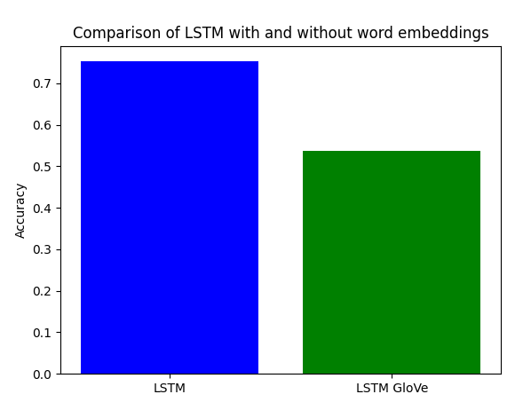
<br>
<br>

So looks like it added more data than it needed than and kind of made the accuracy much worse as compared to with LSTM.

We understood the importance of text pre-processing in NLP tasks. We learned the role and benefits of word embeddings like word two, vec and glove. We gained practical experience using pre-trained embeddings in deep learning models and we compared and interpreted the performance of models without with and without embeddings.


[⬆ Back to content](#content)


## 22. Day 20: Sequence-to-Sequence Models and Applications

[⬆ Back to content](#content)

**Sequence-to-Sequence (Seq2Seq) Models and Their Architecture**

- What are Seq2Seq Models?
  - Map an input sequence to an output sequence of different lengths
  - Widely used for task like language translation, text summarization, speech-to-text and chatbots
  - Architecture
    - Encoder: Processes the input sequence and encodes it into a fixed-length (context vector)
    - Decoder: Takes the context vector as input and generates the output sequence step by step


**Encoder-Decoder Framework for Seq2Seq Tasks**

- How It Works
  - Encoder
    - Sequentially processes the input sequence using RNN, LSTM or GRU
    - Produces a context vector representing the entire input sequence
  - Decoder
    - Initializes its hidden state with the encoder's context vector
    - Generates the output sequence one token at a time
    - Predicts the next token using the previously generated tokens


**Attention Mechanism Overview**

- Why Attention?
  - Standard Seq2Seq models compress the entire input sequence into a fixed-length vector, which can lead to information loss for long sequences
  - Attention Mechanism dynamically focuses on different parts of the input sequence when generating each output token
- How Attention Work?
  - Calculates a wight (score) for each input token based on its relevance to the current decoder state
  - Outputs a weighted sum of the encoder outputs, creating a context vector for each decoder step


**Hands-On Exercise**

Objective: Build a basic Seq2Seq model using LSTMs for translation and experiment with hyperparameters


day20_ex.py

```python
# Import Libraries
## Pytorch
import torch
## nn is used for building neural networks
import torch.nn as nn
## optim is used for optimizing neural networks
import torch.optim as optim
## utilities for working with data set which includes data loader for batching and tensor data set for packaging data.
## DataLoader is used to load data in batches
## TensorDataset is used to create a dataset from tensors
from torch.utils.data import DataLoader, Dataset
## numpy is used for numerical operations
import numpy as np

# Example English-to-French sentences
english_sentences = ["hello", "how are you", "good morning", "thank you", "good night"]
french_sentences = ["bonjour", "comment ça va", "bon matin", "merci", "bonne nuit"]

# Vocabulary and tokenization function
def build_vocab(sentences):
    # Initialize the vocabulary with four special tokens:
    # <PAD> pads shorter sequences to a uniform length
    # <SOS> marks the Start Of a Sequence
    # <EOS> marks the End Of a Sequence
    # <UNK> represents any Unknown word not seen during training
    vocab = {"<PAD>":0, "<SOS>": 1, "<EOS>":2, "<UNK>":3}
    for sentence in sentences:
        for word in sentence.split():
            # Only add the word if it hasn't been seen before
            if word not in vocab:
                # Assign the next available integer index to this new word
                vocab[word] = len(vocab)
    return vocab

# Build separate vocabularies for source (English) and target (French) languages
english_vocab = build_vocab(english_sentences)
french_vocab = build_vocab(french_sentences)

# Tokenize and pad sentences
def tokenize(sentences, vocab, max_len):
    tokenized = []
    for sentence in sentences:
        # Convert each word to its integer index; fall back to <UNK> if unseen
        tokens = [vocab.get(word, vocab['<UNK>']) for word in sentence.split()]
        # Wrap the token sequence with <SOS> at the start and <EOS> at the end
        tokens = [vocab["<SOS>"]] + tokens + [vocab["<EOS>"]]
        # Pad with <PAD> tokens so every sequence reaches the same max_len
        tokens += [vocab["<PAD>"]] * (max_len - len(tokens))
        tokenized.append(tokens)
    # Return a 2-D NumPy array of shape (num_sentences, max_len)
    return np.array(tokenized)

# Take the maximum length of the sentences
max_len_eng = max(len(sentence.split()) for sentence in english_sentences) + 2
max_len_fr = max(len(sentence.split()) for sentence in french_sentences) + 2

# Tokenize and pad sentences
english_data = tokenize(english_sentences, english_vocab, max_len_eng).astype(np.int64)
french_data  = tokenize(french_sentences,  french_vocab,  max_len_fr).astype(np.int64)

class TranslationDataset(Dataset):
    def __init__(self, src_data, tgt_data):
        # Store the source (English) and target (French) token arrays
        self.src_data = src_data
        self.tgt_data = tgt_data
    
    def __len__(self):
        # Return the total number of sentence pairs in the dataset
        return len(self.src_data)
    
    def __getitem__(self, idx):
        # Return a single (source, target) pair as PyTorch Long tensors
        # Long (int64) is required by nn.Embedding, which expects integer indices
        return torch.tensor(self.src_data[idx], dtype=torch.long), torch.tensor(self.tgt_data[idx], dtype=torch.long)

# Instantiate the dataset with the tokenised arrays
dataset = TranslationDataset(english_data, french_data)
# Wrap the dataset in a DataLoader:
# batch_size=2 yields 2 sentence pairs per training step
# shuffle=True randomises the order each epoch to improve generalisation
dataloader = DataLoader(dataset, batch_size=2, shuffle=True)

# Define the encoder and decoder
class Encoder(nn.Module):
    # input_dim  – vocabulary size of the source language (number of unique tokens)
    # embed_dim  – size of each word embedding vector
    # hidden_dim – number of hidden units in each LSTM layer
    # num_layers – number of stacked LSTM layers
    def __init__(self, input_dim, embed_dim, hidden_dim, num_layers):
        # Initialise the parent nn.Module class
        super(Encoder, self).__init__()
        # Embedding layer: maps each integer token index to a dense vector of size embed_dim.
        # Acts as a lookup table of shape (input_dim, embed_dim).
        self.embedding = nn.Embedding(input_dim, embed_dim)
        # LSTM layer: processes the sequence of embeddings and captures temporal dependencies.
        # batch_first=True means input/output tensors have shape (batch, seq_len, features)
        # rather than the default (seq_len, batch, features).
        self.lstm = nn.LSTM(embed_dim, hidden_dim, num_layers, batch_first=True)
        
    def forward(self, x):
        # Convert integer token indices into dense embedding vectors
        # Shape: (batch_size, src_seq_len, embed_dim)
        embedded = self.embedding(x)
        # Feed embeddings through the LSTM.
        # outputs – hidden states for every time step, shape (batch, src_seq_len, hidden_dim)
        # hidden  – final hidden state for each layer,  shape (num_layers, batch, hidden_dim)
        # cell    – final cell state for each layer,    shape (num_layers, batch, hidden_dim)
        outputs, (hidden, cell) = self.lstm(embedded)
        # Only the final hidden and cell states are needed; they carry the full source context
        # and will be used to initialise the Decoder.
        return hidden, cell

# Define the decoder
class Decoder(nn.Module):
    # output_dim – vocabulary size of the target language (number of unique tokens)
    # embed_dim  – size of each word embedding vector
    # hidden_dim – number of hidden units in each LSTM layer (must match Encoder)
    # num_layers – number of stacked LSTM layers (must match Encoder)
    def __init__(self, output_dim, embed_dim, hidden_dim, num_layers):
        # Initialise the parent nn.Module class
        super(Decoder, self).__init__()
        # Embedding layer: maps each target token index to a dense embedding vector
        self.embedding = nn.Embedding(output_dim, embed_dim)
        # LSTM layer: generates the next hidden state given the current token and previous state.
        # batch_first=True keeps shapes consistent with the Encoder.
        self.lstm = nn.LSTM(embed_dim, hidden_dim, num_layers, batch_first=True)
        # Fully connected (linear) layer: projects the LSTM hidden state to a score
        # over every word in the target vocabulary, shape (hidden_dim → output_dim)
        self.fc = nn.Linear(hidden_dim, output_dim)
        
    # forward pass
    def forward(self, x, hidden, cell):
        # x arrives as a 1-D tensor of token indices, shape (batch_size,).
        # unsqueeze(1) adds a sequence-length dimension → shape (batch_size, 1)
        # so the LSTM receives a single time step per call
        x = x.unsqueeze(1)
        # Embed the single input token → shape (batch_size, 1, embed_dim)
        embedded = self.embedding(x)
        # Run one LSTM step, conditioned on the previous hidden and cell states.
        # outputs shape: (batch_size, 1, hidden_dim)
        outputs, (hidden, cell) = self.lstm(embedded, (hidden, cell))
        # Remove the sequence-length dimension: (batch_size, 1, hidden_dim) → (batch_size, hidden_dim)
        # then project to vocabulary scores → shape (batch_size, output_dim)
        predictions = self.fc(outputs.squeeze(1))
        # Return raw logits plus the updated states for the next decoding step
        return predictions, hidden, cell
    
# Define the Seq2Seq model
class Seq2Seq(nn.Module):
    # initialize the model
    def __init__(self, encoder, decoder, device):
        # call the parent class constructor
        super(Seq2Seq, self).__init__()
        # store the encoder, decoder and device as instance properties
        self.encoder = encoder
        self.decoder = decoder
        self.device = device
    
    # src                  – source (English) token tensor,  shape (batch, src_len)
    # tgt                  – target (French)  token tensor,  shape (batch, tgt_len)
    # teacher_forcing_ratio – probability of using the ground-truth token (vs. the model's
    #                         own prediction) as the next decoder input during training
    def forward(self, src, tgt, teacher_forcing_ratio=0.5):
        # Number of sequences processed in parallel
        batch_size = src.size(0)
        # Length of the target sequence (including <SOS> and <EOS>)
        tgt_len = tgt.size(1)
        # Size of the target-language vocabulary (output dimension of the linear layer)
        tgt_vocab_size = self.decoder.fc.out_features
        
        # Pre-allocate a tensor to store the decoder's output logits at every time step.
        # Shape: (batch_size, tgt_len, tgt_vocab_size); initialised to zeros.
        outputs = torch.zeros(batch_size, tgt_len, tgt_vocab_size).to(self.device)
        
        # Encode the full source sequence; returns the final hidden and cell states
        hidden, cell = self.encoder(src)
        
        # Seed the decoder with the <SOS> token (first column of the target tensor)
        input = tgt[:, 0]
        
        # Generate one target token at a time, starting from position 1
        # (position 0 is the <SOS> token used to prime the decoder)
        for t in range(1, tgt_len):
            # Run a single decoder step; output shape: (batch_size, tgt_vocab_size)
            output, hidden, cell = self.decoder(input, hidden, cell)
            # Store this step's logits in the pre-allocated outputs tensor
            outputs[:, t, :] = output
            # Greedy prediction: pick the token with the highest score
            top1 = output.argmax(1)
            # Teacher forcing: with probability teacher_forcing_ratio use the real
            # next token from the target sequence; otherwise use the model's own prediction.
            # This helps stabilise early training while gradually forcing the model
            # to rely on its own outputs.
            input = tgt[:, t] if torch.rand(1).item() < teacher_forcing_ratio else top1
            
        return outputs
    
# Use GPU if available, otherwise fall back to CPU
device = torch.device("cuda" if torch.cuda.is_available() else "cpu")

# Vocabulary sizes determine the embedding table dimensions
input_dim = len(english_vocab)
output_dim = len(french_vocab)

# Hyperparameters – can be tuned to trade model capacity against training speed
embed_dim = 64      # Dimensionality of word embedding vectors
hidden_dim = 128    # Number of units in each LSTM hidden state
num_layers = 2      # Number of stacked LSTM layers in both Encoder and Decoder

# Build sub-modules and compose them into the full Seq2Seq model
encoder = Encoder(input_dim, embed_dim, hidden_dim, num_layers)
decoder = Decoder(output_dim, embed_dim, hidden_dim, num_layers)
model = Seq2Seq(encoder, decoder, device).to(device)

# Adam optimiser: adapts the learning rate per-parameter, generally a strong default
optimizer = optim.Adam(model.parameters(), lr=0.001)

# CrossEntropyLoss combines LogSoftmax + NLLLoss internally.
# ignore_index tells the loss to skip <PAD> positions so they don't affect gradients.
criterion = nn.CrossEntropyLoss(ignore_index=french_vocab["<PAD>"])

# Training Loop
def train(model, dataloader, optimizer, criterion, device, num_epochs=20):
    # Put the model in training mode: enables dropout, batch norm updates, etc.
    model.train()
    for epoch in range(num_epochs):
        epoch_loss = 0                  # Accumulate loss across all batches in this epoch
        for src, tgt in dataloader:
            # Move tensors to the configured device (CPU or GPU)
            src, tgt = src.to(device), tgt.to(device)
            
            # Clear gradients from the previous batch to prevent accumulation
            optimizer.zero_grad()
            # Forward pass: produce logits for every target time step
            output = model(src, tgt)
            
            # Reshape for the loss function:
            # Skip the first time step (index 0) because it is always <SOS>
            # and has no corresponding prediction in outputs.
            # output reshaped: (batch * (tgt_len-1), tgt_vocab_size)
            output = output[:, 1:].reshape(-1, output.shape[2])
            # tgt reshaped:   (batch * (tgt_len-1),)
            tgt = tgt[:, 1:].reshape(-1)
            
            # Compute cross-entropy loss between predictions and ground-truth tokens
            loss = criterion(output, tgt)
            # Backpropagate: compute gradients of the loss w.r.t. all parameters
            loss.backward()
            # Update model parameters using the computed gradients
            optimizer.step()
            # Accumulate the scalar loss value for reporting
            epoch_loss += loss.item()
            
        # Print the average loss over all batches for this epoch
        print(f"Epoch {epoch+1},/{num_epochs}, Loss: {epoch_loss / len(dataloader):.4f}")

# Kick off training
train(model, dataloader, optimizer, criterion, device)

# Inference: Translate a single sentence
def translate_sentence(model, sentence, english_vocab, french_vocab, max_len_fr, device):
    # Switch to evaluation mode: disables dropout and stops gradient tracking
    model.eval()
    
    # Tokenise the input sentence using the English vocabulary
    tokens = [english_vocab.get(word, english_vocab["<UNK>"]) for word in sentence.split()]
    # Wrap with <SOS> and <EOS> markers
    tokens = [english_vocab["<SOS>"]] + tokens + [english_vocab["<EOS>"]]
    # Convert to a tensor and add a batch dimension of 1 → shape (1, src_len)
    src = torch.tensor(tokens).unsqueeze(0).to(device)
    
    # Encode the source sentence; no gradients needed during inference
    with torch.no_grad():
        hidden, cell = model.encoder(src)
    
    # Build the inverse French vocabulary: index → word (for converting predictions back to text)
    tgt_vocab = {v:k for k, v in french_vocab.items()}
    
    # Start decoding with the <SOS> token
    tgt_indices = [french_vocab["<SOS>"]]
    
    for _ in range(max_len_fr):
        # Feed the most recently predicted token index into the decoder
        tgt_tensor = torch.tensor([tgt_indices[-1]]).to(device)
        output, hidden, cell = model.decoder(tgt_tensor, hidden, cell)
        
        # Greedy decoding: select the token with the highest logit score
        pred = output.argmax(1).item()
        tgt_indices.append(pred)
        
        # Stop generating once the <EOS> token is predicted
        if pred == french_vocab["<EOS>"]:
            break
    # Convert predicted indices back to words, skipping <SOS> (first) and <EOS> (last)
    translated_sentence = [tgt_vocab[i] for i in tgt_indices[1:-1]]
    # Join individual word tokens into a single string
    return " ".join(translated_sentence)

# Test Translation
sentence = "good night"
translation = translate_sentence(model, sentence, english_vocab, french_vocab, max_len_fr, device)
print(f"Translated Sentence: {translation}")

```

Run the file
    terminal --> python day20_ex.py

Result:

Epoch 3,/20, Loss: 2.3981       
Epoch 4,/20, Loss: 2.2938       
Epoch 5,/20, Loss: 2.0653       
Epoch 6,/20, Loss: 1.9589       
Epoch 7,/20, Loss: 1.7861       
Epoch 8,/20, Loss: 1.6408       
Epoch 9,/20, Loss: 1.5540       
Epoch 10,/20, Loss: 1.4138      
Epoch 11,/20, Loss: 1.2464      
Epoch 12,/20, Loss: 1.0492      
Epoch 13,/20, Loss: 1.0330      
Epoch 14,/20, Loss: 0.7161      
Epoch 15,/20, Loss: 0.7320      
Epoch 16,/20, Loss: 0.5764      
Epoch 17,/20, Loss: 0.4009      
Epoch 18,/20, Loss: 0.3997      
Epoch 19,/20, Loss: 0.3778      
Epoch 20,/20, Loss: 0.2709      
Translated Sentence: bonne nuit     

We can try with different phrase and the result will be appropriate.


[⬆ Back to content](#content)


## 23. Day 21: RNN Project – Text Generation or Sentiment Analysis

[⬆ Back to content](#content)

**Applying RNN, LSTM and GRU Models to a Complete Task**

- Project Overview
  - Choose a task: Sentiment Analysis will classify text into categories like positive or negative sentiment
  - Use RNN, LSTM and GRU models to solve the chosen task
  - Focus on preprocessing embedding integration model architecture and hyperparameter tuning


**Analyzing the Model Performance**

- Key Metrics
  - For Sentiment Analysis
    - Accuracy, Precision, recall and F1 Score
  - Tuning Hyperparameters
    - Embedding size
    - Number of hidden units
    - Learning rate and optimizer choice 
    - Sequence length and batch size


**Experimenting with Architecture and Techniques**

- Architectural Variations
  - Single-Layer vs. Multi-Layer RNNs
  - Bidirectional RNNs for improved context capture
- Preprocessing techniques
  - Tokenization, stemming and lemmatization and
  - Padding for sequence uniformity


**Hands-On Exercise**

Objective: Build, train and optimize RNN, LSTM, and GRU models for sentiment analysis.

day21_ex.py

```python
# import ready dataset - a standard data set for sentiment analysis, where each review is represented as a sequence of integers
from tensorflow.keras.datasets import imdb
# pad_sequences is used to ensure all sequences which are reviews are of the same length by padding or truncating them
from tensorflow.keras.preprocessing.sequence import pad_sequences
# Sequential class used for building a sequential which is layer by layer model
from tensorflow.keras.models import Sequential
# These are these import specific layers
# Embedding converts word indices to dense vectors. SimpleRNN implements a basic RNN layer, Dense is fully connected layer for output 
# LSTM is long short term memory, GRU is gated recurrent unit
from tensorflow.keras.layers import Embedding, SimpleRNN, Dense, LSTM, GRU
# matplotlib is a library for creating static, animated, and interactive visualizations in Python
import matplotlib.pyplot as plt

# Hyperparameters
## vocabulary size - the top 10,000 most frequent words will be used
vocab_size = 10000
## This is the maximum sequence length. Reviews will be truncated or padded to 100 words, so every review is 100 words.
max_len = 100

# Load the dataset and set training and testing data
## X_train, y_train, X_test, y_test are lists of integers representing word indices and binary label zero for negative and one for positive for the y I items.
(X_train, y_train), (X_test, y_test) = imdb.load_data(num_words= vocab_size)

# Pad Sequences
# Preprocess the data
## Ensuring that all the reviews have the same length, which is max_len=200 and pad sequences with zeros at the end, which that's why we mentioned "post".
## Padding happens at the end and truncates reviews longer than 200 words if it's more than 200 words.
X_train = pad_sequences(X_train, maxlen=max_len, padding="post")
## Same thing for our test data set
X_test = pad_sequences(X_test, maxlen=max_len, padding="post")

# Print shapes of the datasets
print(f"Training data shape: {X_train.shape}, {y_train.shape}")
print(f"Test data shape: {X_test.shape}, {y_test.shape}")

# Define the RNN model
## Using sequential, which is a model built for stacking layers sequentially
rnn_model = Sequential([
    ## setting input dim equal to vocab size where input vocabulary size is 10,000 words and output dim equal to 128,
    ## where each word index is mapped to a 128 dimensional vector
    Embedding(input_dim=vocab_size, output_dim=128),
    # initializing simple RNN with 128 hidden units, 
    ## activation is tanh, 
    ## return_sequences=False - outputs only the last time steps results.
    SimpleRNN(128, activation='tanh'),
    # creating a fully connected output layer using dense
    ## The 1 is the outputs a single value for binary classification
    ## activation is sigmoid - ensures the output is between 0 and 1 one probability
    Dense(1, activation='sigmoid')
])

# Compile the model
## optimizer='adam' - optimization algorithm for training the model
## loss='binary_crossentropy' - function for calculating loss for binary classification
## metrics=['accuracy'] - tracks the model accuracy during training process
rnn_model.compile(optimizer='adam', loss='binary_crossentropy', metrics=['accuracy'])

# Display the model summary including layers, parameters and output shapes
rnn_model.summary()

# Define the LSTM Model
## Using sequential, which is a model built for stacking layers sequentially
lstm_model = Sequential([
    ## setting input dim equal to vocab size where input vocabulary size is 10,000 words and output dim equal to 128,
    ## where each word index is mapped to a 128 dimensional vector
    Embedding(input_dim=vocab_size, output_dim=128),
    # initializing simple RNN with 128 hidden units, 
    ## activation is tanh, 
    ## return_sequences=False - outputs only the last time steps results.
    LSTM(128, activation='tanh'),
    # creating a fully connected output layer using dense
    ## The 1 is the outputs a single value for binary classification
    ## activation is sigmoid - ensures the output is between 0 and 1 one probability
    Dense(1, activation='sigmoid')
])

# Compile the LSTM model
## optimizer='adam' - optimization algorithm for training the model
## loss='binary_crossentropy' - function for calculating loss for binary classification
## metrics=['accuracy'] - tracks the model accuracy during training process
lstm_model.compile(optimizer='adam', loss='binary_crossentropy', metrics=['accuracy'])

# Display the model summary including layers, parameters and output shapes
lstm_model.summary()

# Define the GRU Model
gru_model = Sequential([
    ## setting input dim equal to vocab size where input vocabulary size is 10,000 words and output dim equal to 128,
    ## where each word index is mapped to a 128 dimensional vector
    Embedding(input_dim=vocab_size, output_dim=128),
    # initializing simple RNN with 128 hidden units, 
    ## activation is tanh, 
    ## return_sequences=False - outputs only the last time steps results.
    GRU(128, activation='tanh'),
    # creating a fully connected output layer using dense
    ## The 1 is the outputs a single value for binary classification
    ## activation is sigmoid - ensures the output is between 0 and 1 one probability
    Dense(1, activation='sigmoid')
])

# Compile the GRU model
## optimizer='adam' - optimization algorithm for training the model
## loss='binary_crossentropy' - function for calculating loss for binary classification
## metrics=['accuracy'] - tracks the model accuracy during training process
gru_model.compile(optimizer='adam', loss='binary_crossentropy', metrics=['accuracy'])

# Display the model summary including layers, parameters and output shapes
gru_model.summary()

# Train all models
## X_train, y_train - training data and labels
## epochs=5 - number of epochs to train the model - five iterations over data set
## batch_size=64 - number of samples per batch - 64 processes 64 samples at a time.
## validation_split=0.2 - uses 20% of the training data for validation

# Train RNN model
history_rnn = rnn_model.fit(X_train, y_train, validation_split=0.2, epochs=5, batch_size=64, verbose=1)

# Train LSTM model
history_lstm = lstm_model.fit(X_train, y_train, validation_split=0.2, epochs=5, batch_size=64, verbose=1)

# Train GRU model
history_gru = gru_model.fit(X_train, y_train, validation_split=0.2, epochs=5, batch_size=64, verbose=1)

# Evaluate models
## X_test, y_test - test data and labels
loss_rnn, accuracy_rnn = rnn_model.evaluate(X_test, y_test, verbose=0)
loss_lstm, accuracy_lstm = lstm_model.evaluate(X_test, y_test, verbose=0)
loss_gru, accuracy_gru = gru_model.evaluate(X_test, y_test, verbose=0)

print(f"RNN Test Accuracy: {accuracy_rnn:.4f}")
print(f"LSTM Test Accuracy: {accuracy_lstm:.4f}")
print(f"GRU Test Accuracy: {accuracy_gru:.4f}")

# Plot training accuracy
plt.plot(history_rnn.history['accuracy'], label="RNN Training Acuracy")
plt.plot(history_lstm.history['accuracy'], label="LSTM Training Acuracy")
plt.plot(history_gru.history['accuracy'], label="GRU Training Acuracy")
plt.title("Training Accuracy Comparison")
plt.xlabel('Epochs')
plt.ylabel('Accuracy')
plt.legend()
plt.show()

```

Run the file
    terminal --> python day21_ex.py

Result:

Training data shape: (25000, 100), (25000,)   
Test data shape: (25000, 100), (25000,)   

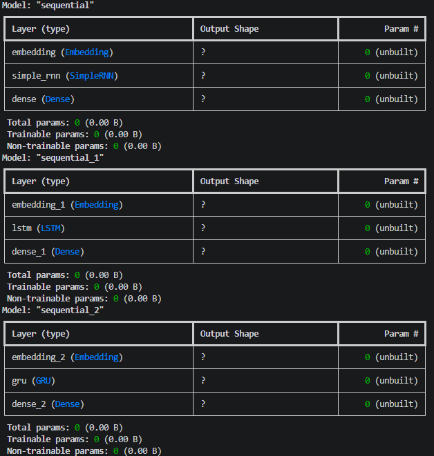
<br>
<br>

RNN Test Accuracy: 0.7562   
LSTM Test Accuracy: 0.8354    
GRU Test Accuracy: 0.8424   


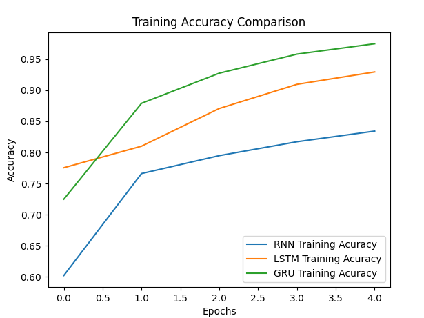
<br>
<br>


We developed skills in pre-processing text data sets for sequence based tasks. We understood how to build, train and compare RNN, LSTM and GRU models, which are very prominent in industry these days. And we learned the challenges and limitations of sequence modeling and how to address them. We gained experience in hyperparameter tuning and also performance evaluation.

[⬆ Back to content](#content)